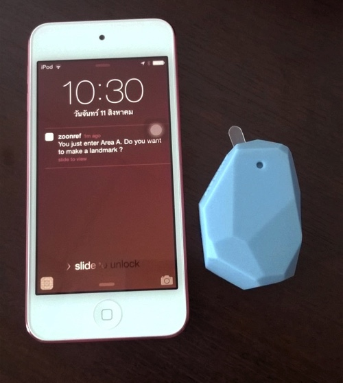

I just got a new project that uses [Estimote](https://estimote.com/). I can't write about the purpose of the app, but I will explain what Estimote is and show an example of how to use it.

## What is an Estimote Beacon?
- - -


{: style="text-align: center"}

>An Estimote Beacon is a small, wireless device, sometimes also called a 'mote'. When placed in a physical space, it broadcasts tiny radio signals to smart devices. — from the Estimote website

So basically it is a small device that broadcasts a radio signal. But what is that signal and how does it work?

An Estimote Beacon broadcasts its signal using [Bluetooth LE](https://en.wikipedia.org/wiki/Bluetooth_low_energy) and the [iBeacon](https://developer.apple.com/ibeacon/) standard, which is implemented using Bluetooth's proximity sensing specification. You can think of it as someone who keeps shouting **"Hey, I am here. My name is ..."** every second.

An Estimote Beacon broadcasts the following significant data:

```
Proximity UUID: B9407F30-F5F8-466E-AFF9-25556B57FE6D
Major: 1234
Minor: 5678
```
**Proximity UUID**: The unique identifier of the beacon. By default, the value is the same for all devices that come from Estimote, but you can change it later.

**Major**: The most significant value of the beacon. You can use it as a group number.

**Minor**: The least significant value of the beacon. You can use it as a member number within the group.

## Development
- - -

The main concept of this app is to notify the user when the phone is close to any of the Estimote devices, and the notification must indicate which device the user is close to. For example, if the phone is close to area A, the user will get a notification like "You just entered area A. Do you want to make a landmark?"

Let's start coding.

### Setup

We need to install the [Estimote SDK](https://github.com/Estimote/iOS-SDK) in our project. You can find the instructions [here](https://github.com/Estimote/iOS-SDK#installation).

### Permission in iOS 8

After you have created and set up the project, the first thing you need to do if you are going to support iOS 8 is to request permission to use location services, due to a policy change. Add the following code wherever you want the user to see the alert dialog, but make sure it is called before using any Estimote functions.

```objc
// request access to location
if ([self.locationManager respondsToSelector:@selector(requestAlwaysAuthorization)]) {
	[self.locationManager requestAlwaysAuthorization];
}
```

I used `respondsToSelector:` because `requestAlwaysAuthorization` is not available prior to iOS 8, so we need to check for it before calling it.

Then add the `NSLocationAlwaysUsageDescription` key to the **Info.plist** file, with a text value that the user will see when the alert dialog pops up.

Do not forget to create `locationManager` as an instance property; otherwise, the alert box will disappear before you can take any action, because the `locationManager` object gets released at the end of the function.

### Area Definition

Next, we are going to create an `Area` class to hold our beacon information.

```objc
@interface Area : NSObject

@property (nonatomic, strong) NSNumber *id;
@property (nonatomic, copy) NSString *name;
@property (nonatomic, copy) NSString *estimoteMajor;
@property (nonatomic, copy) NSString *estimoteMinor;

@end
```
**id**: The ID of the area. We will use it for reference later.

**name**: The name of the area.

**estimoteMajor and estimoteMinor**: The values that indicate which device is associated with this area.

The next step is to create a list of areas in `viewDidLoad` of the root view controller. In this example, we have 3 areas.

```objc
// create areas
Area *areaA = [Area new];
areaA.id = @1;
areaA.name = @"Area A";
areaA.estimoteMajor = @"18407"; // your estimote major value
areaA.estimoteMinor = @"25511"; // your estimote minor value

Area *areaB = [Area new];
areaB.id = @2;
areaB.name = @"Area B";
areaB.estimoteMajor = @"9680";
areaB.estimoteMinor = @"30624";

Area *areaC = [Area new];
areaC.id = @3;
areaC.name = @"Area C";
areaC.estimoteMajor = @"21137";
areaC.estimoteMinor = @"19658";
self.areas = @[areaA,areaB,areaC];

```

### Start Monitoring

We will use the `ESTBeaconManager` class to manage all of our Estimote Beacon tasks and the `ESTBeaconRegion` class to define which region we want to monitor. Put the following code in `viewDidLoad`.

```objc
self.beaconManager = [[ESTBeaconManager alloc] init];
self.beaconManager.delegate = self;

self.beaconRegion = [[ESTBeaconRegion alloc] initWithProximityUUID:ESTIMOTE_PROXIMITY_UUID  identifier:@"Anything"];
[self.beaconManager startMonitoringForRegion:self.beaconRegion];
```

`ESTIMOTE_PROXIMITY_UUID` is a fixed UUID for all Estimote Beacon devices. If you have changed it, you need to change this value to match yours.

Then implement the `ESTBeaconManager` delegate:

```objc
#pragma mark - ESTBeaconManager delegate

- (void)beaconManager:(ESTBeaconManager *)manager didEnterRegion:(ESTBeaconRegion *)region
{
   // phone enter to area
	UILocalNotification *notification = [UILocalNotification new];
	notification.alertBody = @"Enter region notification";
	[[UIApplication sharedApplication] presentLocalNotificationNow:notification];
}

- (void)beaconManager:(ESTBeaconManager *)manager didExitRegion:(ESTBeaconRegion *)region
{
	// phone exit from area
	UILocalNotification *notification = [UILocalNotification new];
	notification.alertBody = @"Exit region notification";
	[[UIApplication sharedApplication] presentLocalNotificationNow:notification];
}
```

The `startMonitoringForRegion:` method works even when the app is in the background, but not after you kill the app.

Now we will get a notification when the phone is close to one of those 3 areas, and also when it leaves the area *(please note that the exit delegate method is called after 30 seconds)*. But wait, how can we know which area we entered: A, B, or C? We have to use another method, `startRangingBeaconsInRegion:`, but that brings a new problem: this method does not work in background mode.

The solution is to use `startMonitoringForRegion:` first. After `beaconManager:didEnterRegion:` is called, iOS allows the app to execute code in the background for 5 seconds. Within those 5 seconds, we use `startRangingBeaconsInRegion:` to find out which beacon device we are close to.

The delegate code will look like this:

```objc
#pragma mark - ESTBeaconManager delegate

- (void)beaconManager:(ESTBeaconManager *)manager didEnterRegion:(ESTBeaconRegion *)region
{
    [self.beaconManager startRangingBeaconsInRegion:self.beaconRegion];
}

- (void)beaconManager:(ESTBeaconManager *)manager didRangeBeacons:(NSArray *)beacons inRegion:(ESTBeaconRegion *)region
{
    ESTBeacon *beacon = (ESTBeacon *)beacons.firstObject;
    Area *detectedArea = nil;
    for (Area *area in self.areas) {
        if (beacon.major.intValue == area.estimoteMajor.intValue &&
            beacon.minor.intValue == area.estimoteMinor.intValue) {
            detectedArea = area;
            break;
        }
    }

    if (detectedArea) {
        UILocalNotification *notification = [UILocalNotification new];
        notification.alertBody = [NSString stringWithFormat:@"You just entered %@. Do you want to make a landmark?",detectedArea.name];

        [[UIApplication sharedApplication] presentLocalNotificationNow:notification];
        [self.beaconManager stopRangingBeaconsInRegion:self.beaconRegion];
    }
}
```

Now, when the app is in the background or the phone is locked, we will get a notification with the area name.


{: style="text-align: center"}

## Conclusion
- - -

With Estimote devices and iBeacon, we can power ideas based on indoor location or proximity, such as a retail shop that notifies users about promotions when they are close to a product, or a [check-in app](https://github.com/panicinc/PunchClock).
