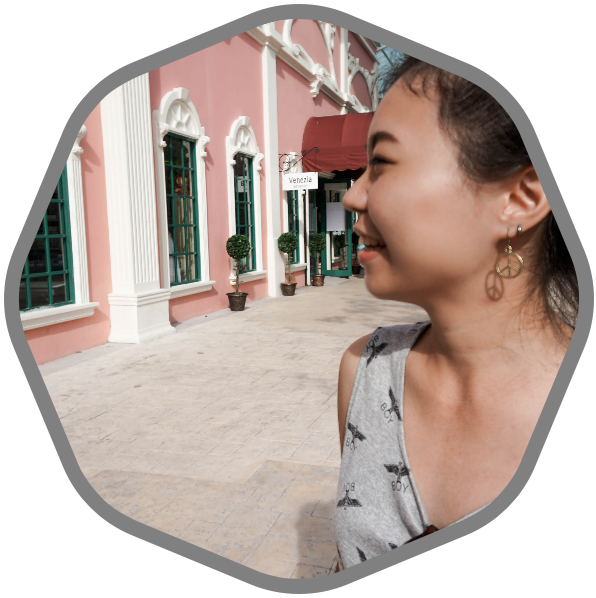
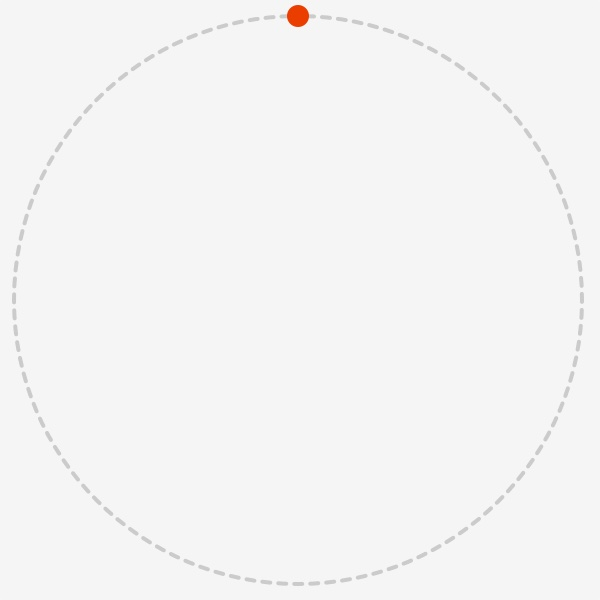
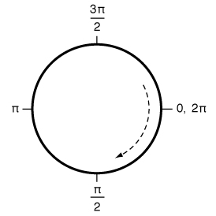
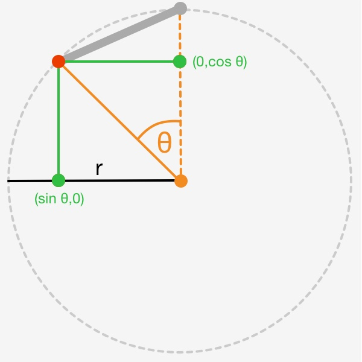
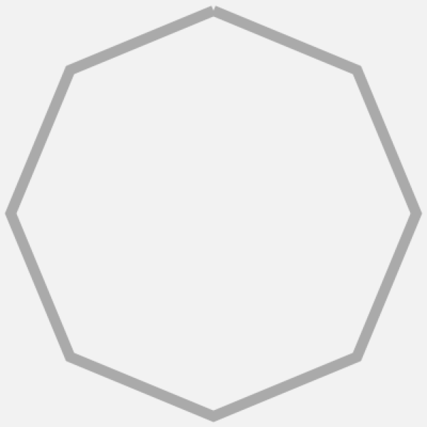
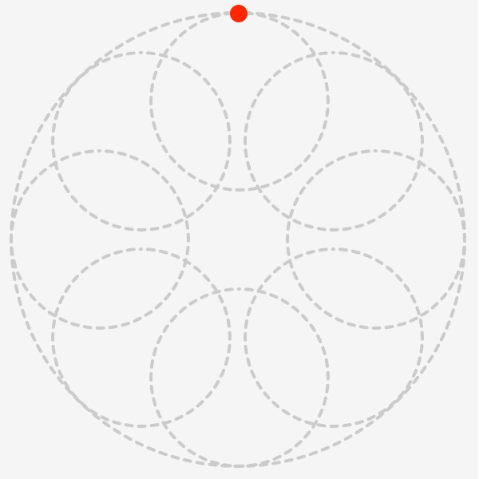
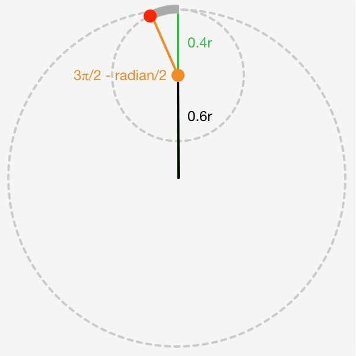
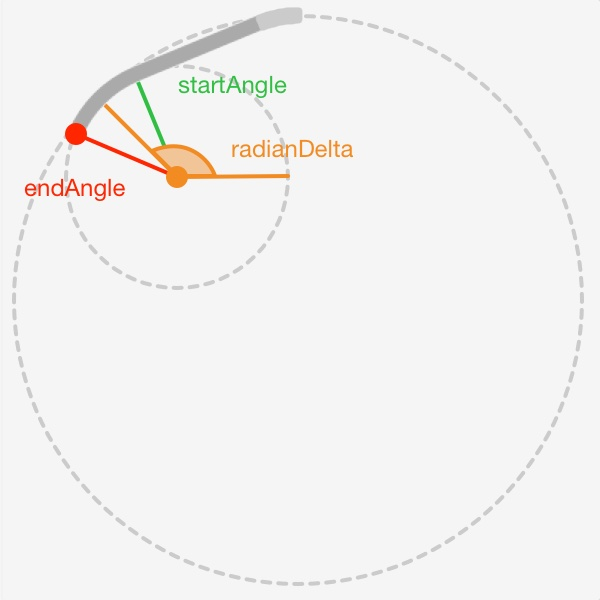
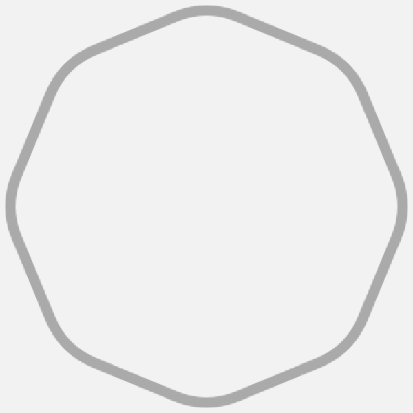

As iOS developers, we have all used the `cornerRadius` property of `CALayer` to make a `UIImageView` rounded or circular to match the designer's mockup. But what if the designer wants something more than that? A polygon? A star? What should we do?

This post will show you how to use `UIBezierPath` to make a dynamic polygon mask for a `UIImageView`, like this:

<center>

</center>

## Create Path

Let's create a new Swift playground so we can see updates as we change the code, and then create a custom `UIView` subclass that draws our path in its `drawRect()` method.

```swift
import UIKit
import Darwin

class CustomView: UIView {
    
    override func drawRect(rect: CGRect) {
        // draw bezier here
    }
    
}

let view = CustomView(frame: CGRectMake(0, 0, 400, 400))
```

### 1. Declare the constants.

Add the following lines to our class.

```swift
let count = 8
let inset: CGFloat = 10
let lineWidth: CGFloat = 10
let lineColor = UIColor.lightGrayColor()
```

`count` is the number of corners in the polygon.  
`inset` is the padding of the view.  
`lineWidth` is the width of the path line.

Then add the following lines to `drawRect()`:

```swift
let insetRect = CGRectInset(rect, inset, inset)
let radius = (insetRect.width > insetRect.height ? insetRect.height : insetRect.width) / 2.0
let center = CGPoint(x: CGRectGetMidX(insetRect), y: CGRectGetMidY(insetRect))
let radian = CGFloat(M_PI * 2) / CGFloat(count)
```

`radius`: our polygon is based on a circle, so we need to know its radius.  
`center`: the center of the view and the circle.  
`radian`: the angle per corner in radians. A complete circle is 2π radians, so the angle per corner is **2π / number of corners**.

### 2. Create a bezier path

Add the following lines to `drawRect()`:

```swift
let path = UIBezierPath()
path.lineWidth = lineWidth
lineColor.setStroke()
```

Then move the start point to the top middle by subtracting `radius` from `center.y`.

```swift
let startPoint = CGPointMake(center.x, center.y - radius)
path.moveToPoint(startPoint)
```

Now we are at the red dot.

<center>

</center>

Next, we need to draw lines to make the polygon. Let's start with the first destination.  
In order to draw a line, we need a **point (x,y)** and an **angle (θ)**. According to Apple's documentation, angles in the default coordinate system look like this:
 
<center>

</center>

So **angle (θ)** is equal to:  

```swift
let θ = CGFloat(3 * M_PI_2) - radian
```

and the **point (x,y)** is equal to:

```swift
let point = CGPoint(
    x: center.x + radius * cos(θ),
    y: center.y + radius * sin(θ)
)
```

You can see this in the following image.

<center>

</center>

Let's use those values in a for-loop and draw the path!

```swift
for i in 1...count  {
    let θ = CGFloat(3 * M_PI_2) - CGFloat(i) * radian
            
    let point = CGPoint(
        x: center.x + radius * cos(θ),
        y: center.y + radius * sin(θ)
    )
    
    path.addLineToPoint(point)
}

path.stroke()
```

Here is the result.

<center>

</center>

But something is missing: the curves at every corner.

### 3. Add curves

Back to the starting point at the red dot. We need to draw curves that are part of a circle, so imagine there is a small circle inside every corner.

<center>

</center>

Because we are at the top center of the circles, we will add the first curve with half of `radian` (every small circle uses the same `radian` value as the big one, because the total is still 2π, or 360 degrees). In order to add a curve, we need a control point, which is the center of the small circle.

Add the following constants before the for-loop:
 
```swift
let subRadius = radius * 0.4
let firstControlPoint = CGPoint(x: startPoint.x, y: startPoint.y + subRadius)
```
You can adjust the `subRadius` multiplier if you want the corners to be more rounded or sharper. Put the following lines above the for-loop to add a curve to our path before entering the loop.

```swift
path.addArcWithCenter(firstControlPoint,
    radius: subRadius,
    startAngle: CGFloat(3 * M_PI_2),
    endAngle: CGFloat(3 * M_PI_2) - radian / 2,
    clockwise: false)
```

You can see this in the following image.

<center>

</center>

Now let's handle the remaining small circles inside the for-loop. After declaring `θ` and `point`, add these lines to find the control point for each corner. We use `0.6` as the radius multiplier because we used `0.4` for `subRadius`.

```swift
let controlPoint = CGPoint(
    x: center.x + (radius * 0.6) * cos(θ),
    y: center.y + (radius * 0.6) * sin(θ)
)
```

We also need the angle of the point where the line touches the small circle, which we get with the `atan2` function. The function takes 2 arguments, the y and x distances from the point to the center of the circle, and returns the angle in radians. You can read more about it at [https://en.wikipedia.org/wiki/Atan2](https://en.wikipedia.org/wiki/Atan2)

```swift
let deltaY = point.y - controlPoint.y
let deltaX = point.x - controlPoint.x
let radianDelta = atan2(deltaY, deltaX)
```

Then we find the angles where the curve starts and ends, using the value we got from `atan2`.

```swift
var startAngle = radianDelta + (radian / 2)
var endAngle = radianDelta - (radian / 2)
```

Remove `path.addLineToPoint(point)`, since we will use `addArcWithCenter()` again instead. It automatically draws a line if the current point is not on the arc, so we do not need to draw straight lines ourselves.

```swift
path.addArcWithCenter(controlPoint,
    radius: subRadius,
    startAngle: startAngle,
    endAngle: endAngle, clockwise: false)
```

You can see this in the following image.

<center>

</center>

Here is the result.

<center>

</center>

### 4. Apply mask to UIImageView

Now that we have a working polygon Bézier path, we need to create a `UIView` subclass that wraps the `UIImageView` and uses the path as a mask with the following code.

```swift
let maskLayer = CAShapeLayer()
maskLayer.path = path.CGPath
imageView.layer.mask = maskLayer

```

## Conclusion

We can use this to create many styles of `UIImageView` by changing the value of `count`, or even rewrite the path to make a star or whatever you want. Don't stick with squares only. You can find the complete source code on [GitHub](https://github.com/zoonooz/PolyImageView).