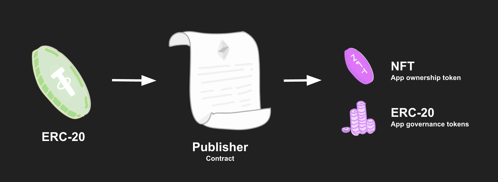
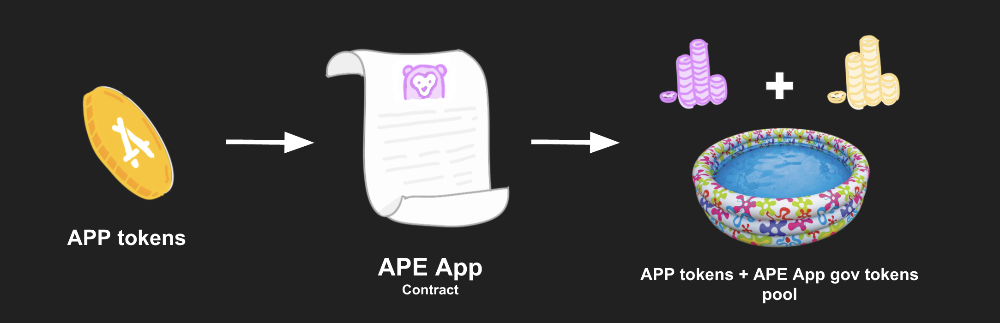
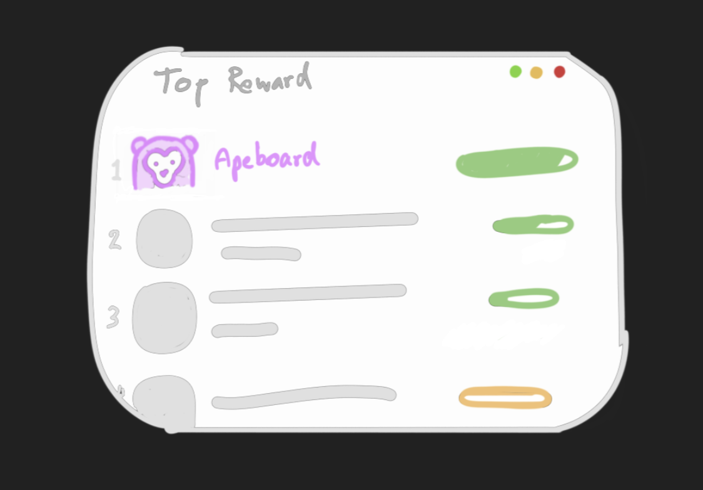
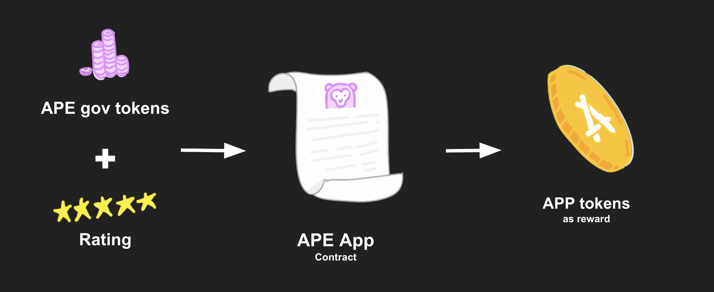

Cryptocurrencies and blockchain are among the hottest topics nowadays, and a ton of new services built on these technologies are coming up every day, trying to disrupt traditional businesses. If we look at the core of what these technologies are trying to solve, it all points to **"centralization"** problems, and I would like to propose an idea to solve one of them.

## Problem
As a mobile developer, the closest centralized thing to me, and one that can sometimes cause problems, is the **App Store**. These problems can affect our users as well as us as app publishers. Look at these examples.

<blockquote class="twitter-tweet">
My phone has lost access to thousands of dollars of apps on <a href="https://twitter.com/GooglePlay?ref_src=twsrc%5Etfw">@GooglePlay</a>. I had just bought LOTR 4K and can&#39;t finish it. My <a href="https://twitter.com/googledrive?ref_src=twsrc%5Etfw">@googledrive</a> data is completely gone. I can&#39;t access my <a href="https://twitter.com/YouTube?ref_src=twsrc%5Etfw">@YouTube</a> channel. The worst of all is losing access to my <a href="https://twitter.com/gmail?ref_src=twsrc%5Etfw">@gmail</a> address of over 15 years.
&mdash; Andrew Spinks (@Demilogic) <a href="https://twitter.com/Demilogic/status/1358661841220730882?ref_src=twsrc%5Etfw">February 8, 2021</a></blockquote> 

*
Andrew lost access to all of his apps because Google decided to ban his account.
*
 

<blockquote class="twitter-tweet">
Wow. I&#39;m literally stunned. Apple just doubled down on their rejection of HEY&#39;s ability to provide bug fixes and new features, unless we submit to their outrageous demand of 15-30% of our revenue. Even worse: We&#39;re told that unless we comply, they&#39;ll REMOVE THE APP.
&mdash; DHH (@dhh) <a href="https://twitter.com/dhh/status/1272968382329942017?ref_src=twsrc%5Etfw">June 16, 2020</a></blockquote> 

*
David could not publish updates to his app because he did not comply with Apple's demand.
*

To summarize, these are the problems:
- You don’t own the apps/games you bought; the store owner just says you do.
- You can’t sell the app you made if the store owner says no.
- A huge fee/commission has to be paid to the store owner.

## Solution
My idea is to create a Decentralized App Store to replace Google Play Store, Steam, or any other centralized software and game store, using blockchain and its decentralized nature to let publishers and users interact directly through smart contracts. Here is how it works from the **user's perspective**:

1. The user pays for the app using stablecoins such as USDT or USDC, or any other ERC-20 token.
2. The contract then mints an NFT that represents ownership of the purchased app and sends it to the user.
3. The user also receives the app-specific governance token for later use, such as voting or reviewing.
4. The user then logs in to the purchased app with the wallet containing the NFT.
  

Let's look at how the idea works from the **publisher's perspective**:

> The APP token is the utility token of this Decentralized App Store.

1. To publish, the publisher needs to acquire some APP tokens on an exchange to pay a fee, which also prevents anyone from spamming the store.
2. A contract for the new app is deployed so that users can purchase it and mint the app NFT. For instance, let's call this app "APE".
3. The publisher has the option to stake more APP tokens into a pool paired with the APE governance token, as an extra reward for users and to promote the app.

If you want your app to be at the top of the list, put in more APP tokens. Once users flock in to purchase your app, the reward will be drained and your app will return to the same level as the others. Repeat whenever you want your app to be at the top again. Anyone can also put APP tokens into the pool to help the publisher and get more of the app's governance tokens in return, which they can use to vote on important decisions about the app. I call this mechanism the **"Automated Advertisement Maker"** :D

*
The higher the reward, the higher the visibility and downloads.
*
 

So how do users claim the reward? Let's think about what publishers want from users after a purchase: feedback. Feedback and reviews are an important part of any app store. They let developers know how to improve their products and help other users decide whether to purchase. With this reward mechanism, we can encourage users to give feedback and get a reward in return (which can be sold on an exchange for real money).

1. The user can submit a review together with any amount of the app's governance token.
2. The contract then swaps the app's governance token to the APP token as a reward.
3. Rating and feedback are recorded on the blockchain.

## Conclusion
The idea is still far from perfect, and there are a lot of aspects I haven't thought through yet, but I believe this could be the future of how we distribute software. Let me know if you like this idea.
