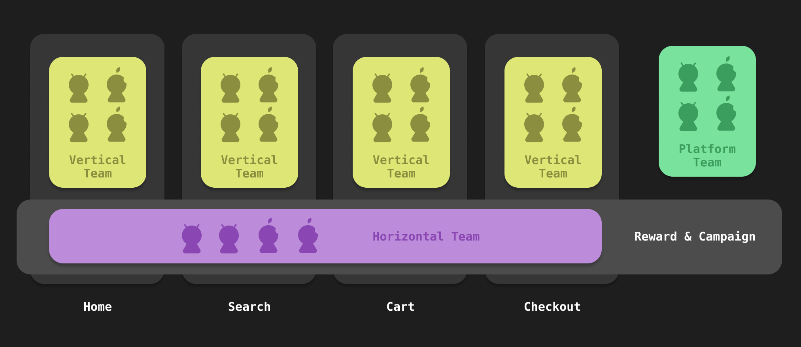
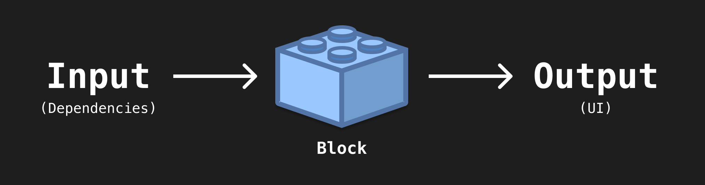
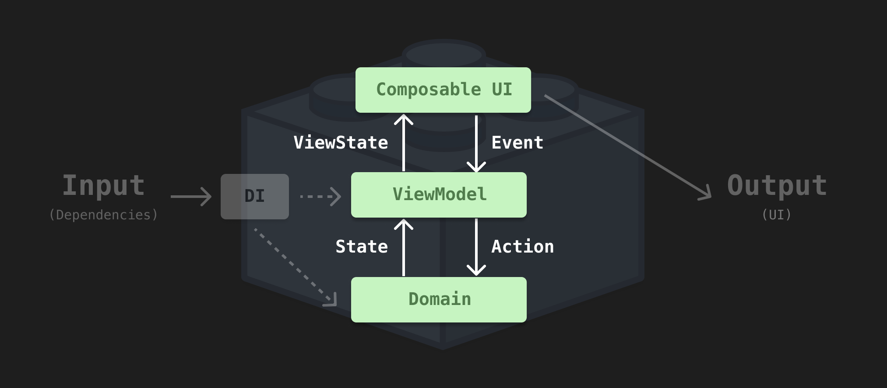
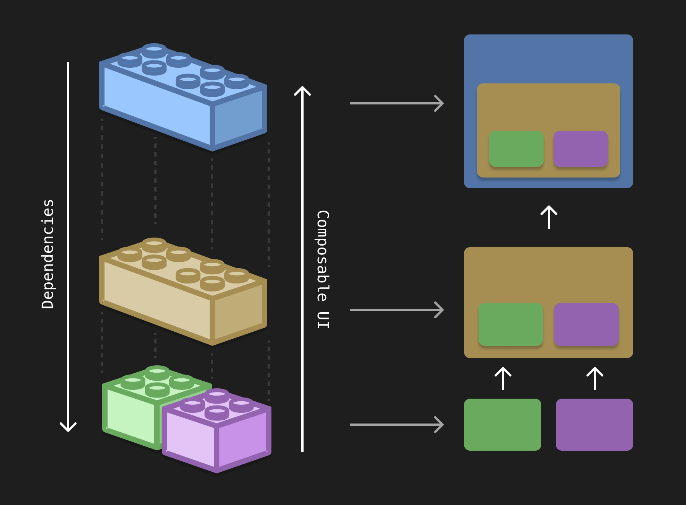
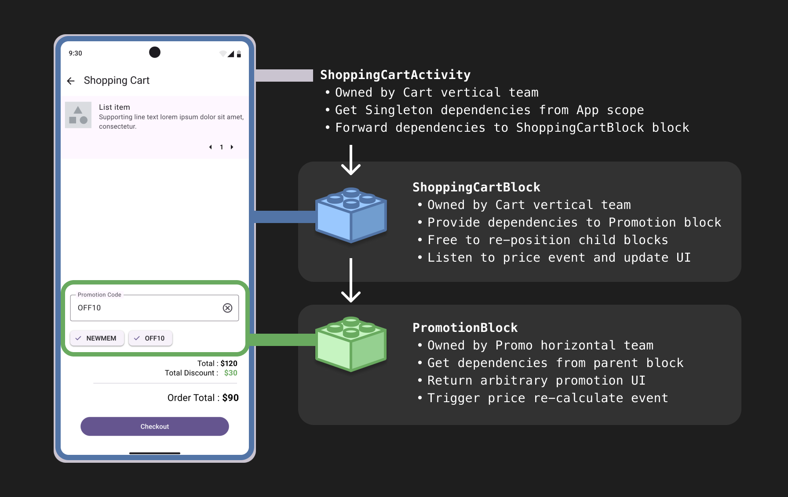

As a mobile developer, you've likely encountered the challenges of a complex app, an entangled codebase, and a continuously growing team. Each new feature feels like adding a block to a Jenga tower that might topple over at any second. And it's not only you: many colleagues on your team are doing the same, and other teams may even add blocks to your tower and knock it over unintentionally.

## Scaling Mobile Team

When a company grows, a single mobile team may struggle to deliver features quickly enough. To address this, companies often hire more engineers to take care of separate parts of the app. These teams typically fall into three categories:

- **Vertical Teams:** These teams focus on specific screens or features within a screen. They own the entire development process for their assigned features, from design and implementation to testing and maintenance.
- **Horizontal Teams:** These teams focus on a specific domain that spreads across multiple screens. For example, a "Rewards Team" might handle integrating promotional features across food delivery, taxi, and shopping screens.
- **Platform Teams:** These teams focus on solving platform-wide technical problems such as performance, infrastructure, and CI/CD.

<center>

</center>

This doesn't sound bad, but the following issues can arise between vertical and horizontal teams:

- **Limited Collaboration:** Teams may not collaborate enough. Changes by horizontal teams can break functionalities or miss context owned by vertical teams. This necessitates thorough code reviews and discussions.
- **Unclear Ownership:** Sometimes, code from horizontal teams needs to be integrated within vertical team code for functionality. This can lead to confusion about ownership and responsibility for maintenance or bug fixes.
- **Human Error:** Even with close collaboration, mistakes are inevitable.

What if we could fix this with architecture?

## Architecture

Instead of looking at the screen as a whole, we can break it down into smaller, independent parts. This allows different teams to own these parts, aligning with the organization's structure and adhering to [Conway's law](https://en.wikipedia.org/wiki/Conway%27s_law). Declarative UI frameworks like Jetpack Compose make this decomposition much easier than before. From here, I'll refer to these screen components as "Blocks".

<center>

</center>

A Block has a clear input and a clear output.

- **Input** is the dependencies: what the Block needs in order to process and return its output.
- **Output** is the user interface. This could be a Fragment or a Composable component.

Here is an example of a Block implementation:

```kotlin
class ShoppingCartBlock(input: ShoppingCartDependencies) {
    ...

    val output: @Composable () -> Unit = {
        // Jetpack Compose Component
    }
}
```

Blocks are pattern-agnostic, which means it is up to each team to choose which pattern to use. For example, a Block can be implemented with MVVM (Model-View-ViewModel).

<center>

</center>

Blocks can then be connected together to form a single UI screen. Let's look at this example UI component, which consists of many parts. Each of them could be produced by a different Block and owned by a different team.

<center>

</center>

Coming back to the shopping screen: if the screen consists of two parts, a shopping cart and a promotion input, we could implement the promotion Block with MVVM like this, using Dagger as the dependency injection framework:

```kotlin
class PromotionBlock(input: PromotionDependencies) {
    private val component by lazy {
        DaggerPromotionBlockComponent.Factory()
            .create(input)
    }

    val output: @Composable () -> Unit = {
        val viewModel = component.viewModel
        PromotionUIComponent(viewModel)
    }
}
```

Inside `ShoppingCartBlock`, we can add `PromotionBlock` as a child Block by initializing it and using its output component:

```kotlin
class ShoppingCartBlock(input: ShoppingCartDependencies) {
    private val component by lazy {
        DaggerShoppingCartBlockComponent.Factory()
            .create(input)
    }

    val output: @Composable () -> Unit = {
        val promotionBlock = PromotionBlock(component)
        ShoppingCartUIComponent(
            vm = component.viewModel,
            promotionSlot = promotionBlock.output
        )
    }
}
```

Now, let's review the current Block tree.

<center>

</center>

> If the app is not a single-page application (SPA), the topmost Block gets its dependencies from the Activity and then forwards the required dependencies to its child Block(s), for instance, the Promotion Block.

### With Block Architecture

- The boundary between teams is clearer, reducing the communication gap and context mixing.
- Each block can be put into its own module, simplifying ownership declaration and promoting maintainability.
- Passing down dependencies from another team's parent Block requires communication between the teams (dependency changes require the parent Block's team to review the PR).
- A Block only cares about its input and output, so each team can decide on its own architecture pattern and conventions.

## Conclusion

With modern declarative UI frameworks, this idea can be implemented on Android and even on iOS using SwiftUI. You can achieve a scalable mobile application architecture without any third-party libraries, which reduces the learning curve for new team members and minimizes the amount of "magic code" the team has to understand. The full demo is coming soon.
