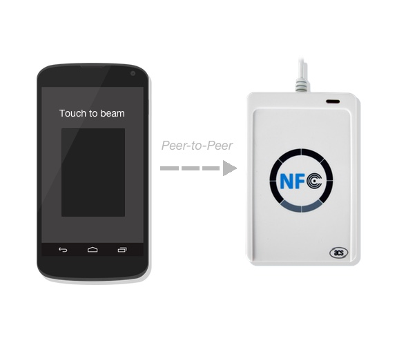

Receive simple NDEF messages (SNEP) pushed from Android ICS in P2P mode via the "Touch to Beam" feature to an ACS ACR122U reader.

{: style="text-align: center"}

  * It can only receive simple text NDEF messages (more than 255 bytes)
  * Uses Initiator mode to manually set LLCP connection parameters

 

##### Tested on

  * ACS ACR122U firmware 207
  * Nexus S with Android ICS 4.0.3

 
 

Thanks to nfcip-java [https://code.google.com/p/nfcip-java/](https://code.google.com/p/nfcip-java/)
