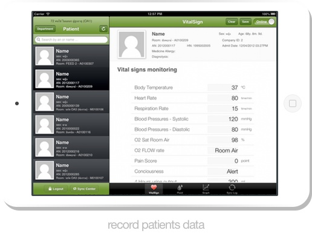
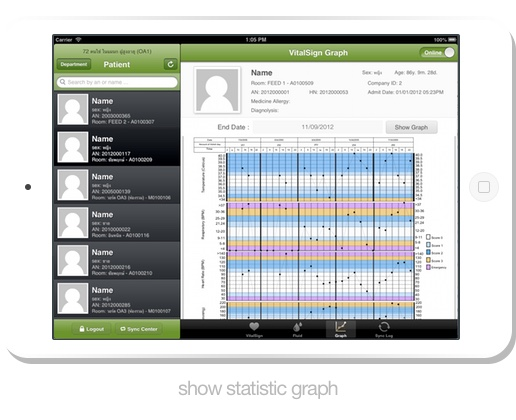
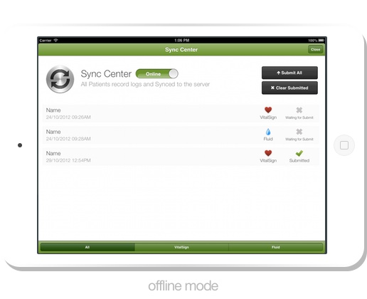

When I was working at Kluaynamthai Hospital, I built an iPad application called **Nurse Note**. The main purpose of the app is to let nurses record patient data.

{: style="text-align: center"}

The app works by fetching a list of patients from a WCF service provided by another team, recording their data, and sending it back to the server. I used [wsdl2objc](https://code.google.com/p/wsdl2objc/) to generate the classes for connecting to the service.

{: style="text-align: center"}

Another requirement was that data could be saved offline when there was no internet connection, and then sent to the server once the connection was available again.

{: style="text-align: center"}
