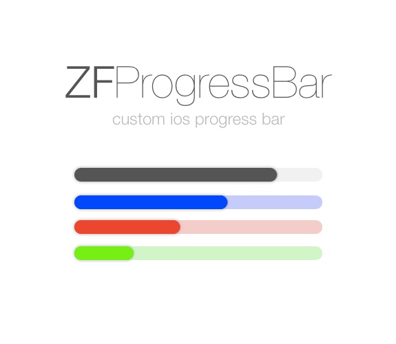

While I was working on a project, I needed to customize the **UIProgressView** in iOS to have colors and a style that matched the app, so I created this simple control.

{: style="text-align: center"}
