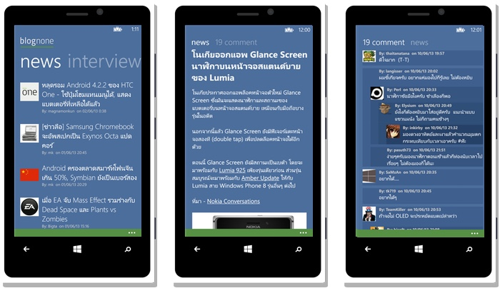
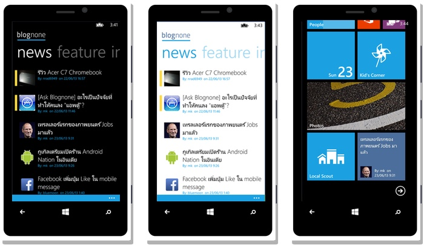

[Blognone](https://www.blognone.com/) is a Thai technology news website that I like to read. After I got a Nokia Lumia 520, I decided to learn this new platform, *Windows Phone*. This was my first Windows Phone app.

{: style="text-align: center"}

The app can display images, YouTube videos, code snippets, and nested comments, and users can share news to social networks. Some features, such as app themes, font sizes, and live tiles, are only available in the paid version.

{: style="text-align: center"}
