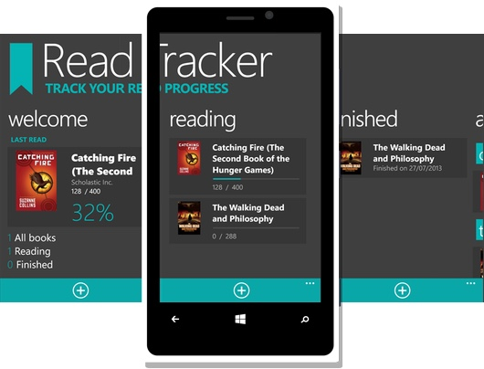
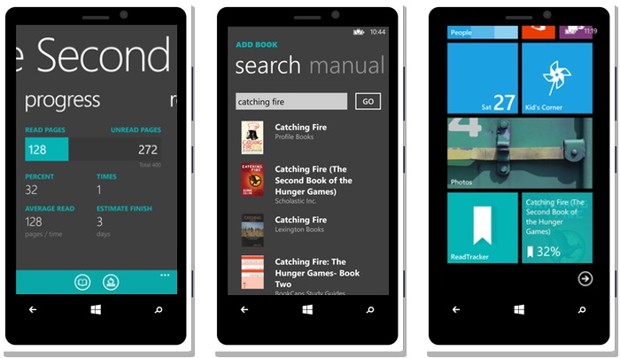

ReadTracker is my second Windows Phone application, which I made in my free time. The app tracks the pages you've read in your books. It's like a bookmark, but in a mobile app.

{: style="text-align: center"}

The app can capture your book covers, search Google by ISBN to fetch book information, and show your reading progress on live tiles.

{: style="text-align: center"}
