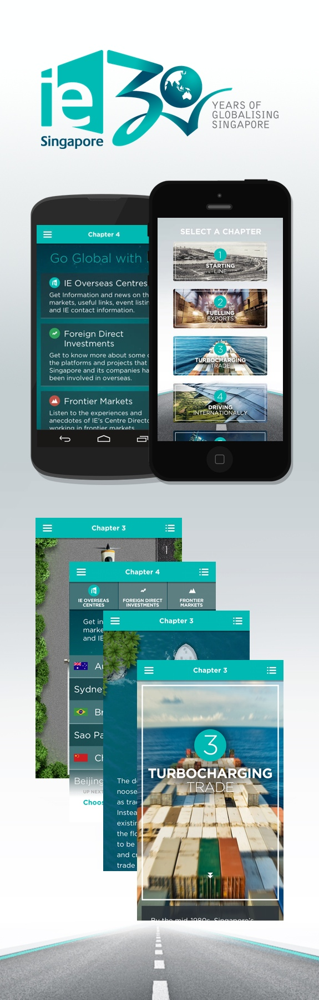
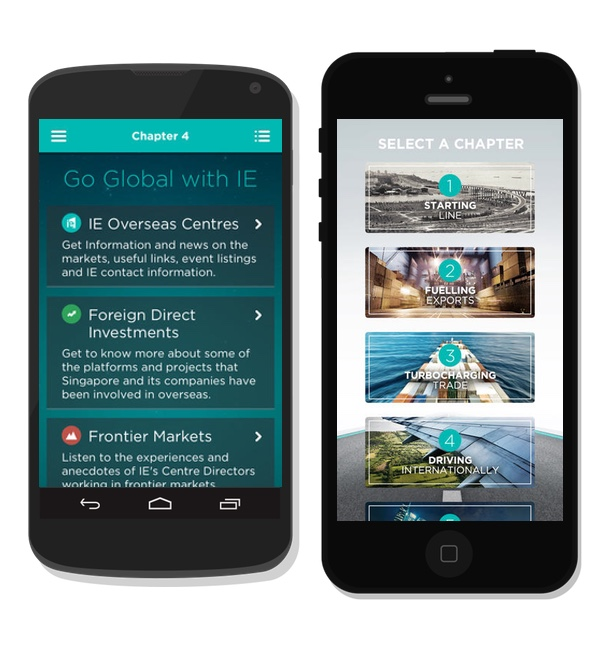

I worked with a designer and another developer at Dezainwerkz to build these applications to celebrate IE Singapore's 30th anniversary and tell the story of Singapore's globalisation journey.

{: style="text-align: center"}

The app mainly tells the story through sounds, videos, and a news feed. My responsibilities were designing the app structure, coding, and bringing the designer's interactions to life.

{: style="text-align: center"}

{: style="text-align: center"}
