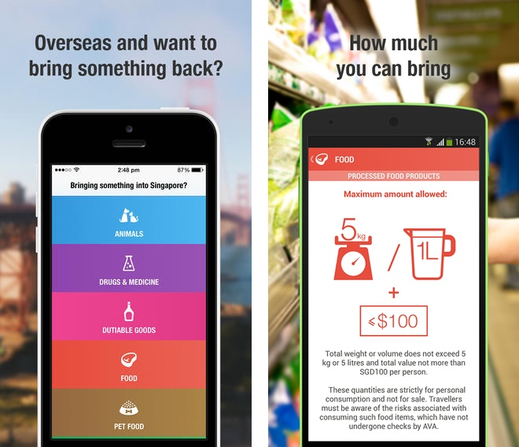

SG TravelKaki is an app that provides important information on what travellers can (and cannot) bring back into Singapore from their overseas trips.

{: style="text-align: center"}

I worked with the team at Dezainwerkz to make this app. Because there was a lot of content and many pages to display, we decided to use **XML** as the common data format and wrote a parser on both platforms to generate and display native UI.

{: style="text-align: center"}

{: style="text-align: center"}
