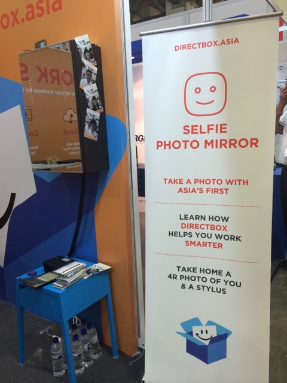

My company was running a marketing campaign for [Directbox](http://directcloud.net/) and building a booth at [CommunicAsia](http://www.communicasia.com/) in Singapore from 17 to 20 June. My boss wanted a mirror that could automatically snap a photo when someone smiled and then print it out at the booth using the [DirectPrint](http://directcloud.net/direct-cloud/) feature.

The app was built for OS X and uses the `CIDetector` class from the standard OS X library to make this happen. It connected to an external webcam for high-resolution photos and to an Arduino that lit up an LED indicator before each snap.

{: style="text-align: center"}
