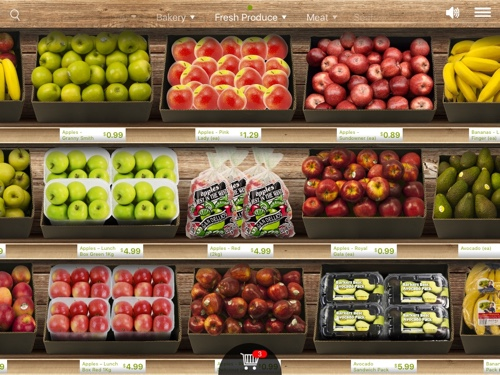
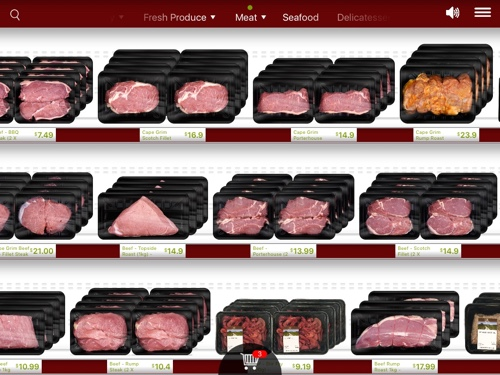

**AisleOne** is a shopping application that simulates a supermarket aisle. Users can scroll left and right to browse products and simply drag and drop them into the cart to buy now or schedule for later.

{: style="text-align: center"}

The most challenging part was making the app as smooth as possible while using as little memory as possible. To make it smooth, I pre-loaded all the images into memory (500+ images). But by doing that, the app got a lot of memory warnings and eventually crashed :(

With no other option, I had to trade frame rate for memory by using `NSCache` to hold references to those images. In the best case, the app is as smooth as before, but in the worst case, it lags a lot. I wanted to use a background thread to load images from disk, render them, and fade them into the cells to keep scrolling smooth, but that would not look realistic!

I worked with the team at Gomeeki to make this app better and more stable.
