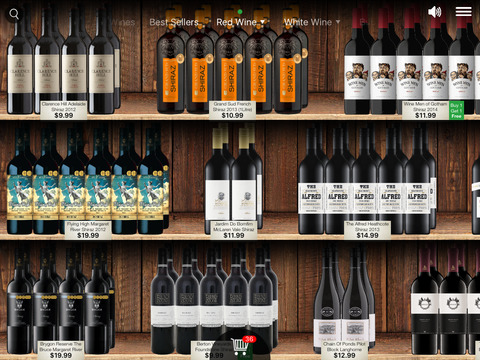

I worked with another iOS developer at Gomeeki to create this application for [GetWinesDirect](https://www.getwinesdirect.com/).

**GetWinesDirect** is a wine shopping application that simulates a wine shelf in the same way as [AisleOne](/portfolio/ios-aisleone), but with different data and structure. Users can scroll left and right to browse products and simply drag and drop them into the cart to purchase.

{: style="text-align: center"}

{: style="text-align: center"}
