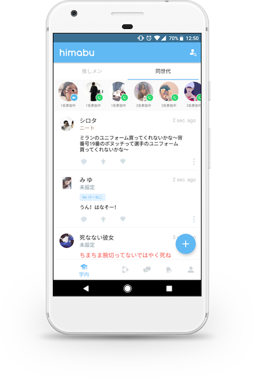

> Himabu was shut down and replaced by [Yay!](https://note.com/yay_official/n/n94e9e7b9f038) on 1 January 2020.

My first application in Japan was Himabu for Android. I worked as an Android developer at [Nanameue](https://nanameue.jp/) to create the Android version of this app, which already existed on the iOS App Store.

**Himabu** is a social application for students. We wanted them to use their free time to communicate, make new friends, and have fun with other students around Japan. Students can create groups, chat, call, or post to a public timeline.

{: style="text-align: center;"}

At first, the app was built entirely in **Java**. Half a year after its release, as the language became more and more stable, I decided to rewrite everything in **Kotlin**. The code is easier to read, and because I use RxJava everywhere, Kotlin's lambda expressions shorten the code a lot.

The app also supports both voice and video conference calls. I created a **WebRTC** wrapper library based on Google's libjingle that handles signaling and ICE for both the iOS and Android apps, and integrated it into both.