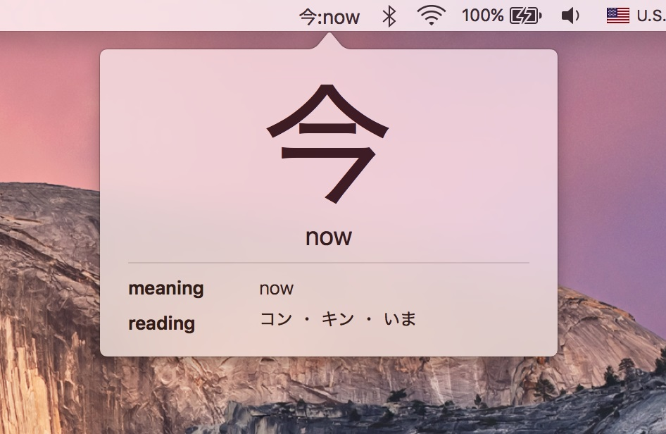

When I was living in Japan, I wanted to learn Japanese and remember the hardest part of the language: **Kanji!**

I created a Mac app that simply shows a random kanji and its meaning in the menu bar. When I open it, I can see all the readings and meanings. The displayed kanji changes periodically, so whenever I glance at it, I can learn a new one or be reminded of one I've already learned.

You can check out the source code on [GitHub](https://github.com/zoonooz/KanjiGlance).

{: style="text-align: center"}
