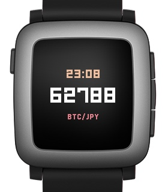

After I got interested in Bitcoin and invested some of my money in it, I became addicted to checking the Bitcoin price all the time.

As I own a Pebble watch, I decided to learn Pebble development and create this simple Bitcoin price watchface, so I can just glance at my wrist to see the current price.

Currently, it can get the latest price from bitFlyer and Coinbase. You can check out the source code on [GitHub](https://github.com/zoonooz/BitcoinWatch) and download it from the [Rebble store](https://store-beta.rebble.io/app/57cc2c33be5ad0d9500002cd).

{: style="text-align: center"}
